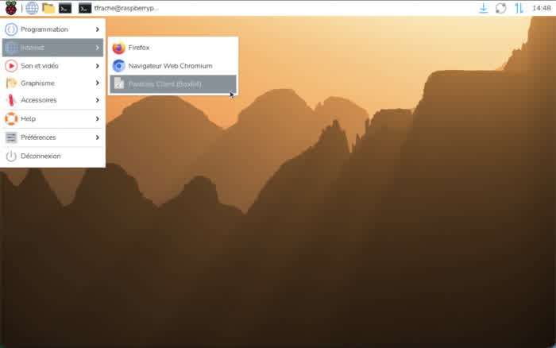

# Raspberry Pi 4 as a Parallels RAS 22 client: an experimental Box64 proof of concept

> **Editorial status:** experimental, unofficial and laboratory-only. This project is independent from Parallels and is not supported or endorsed by Parallels.

## English

A customer request prompted this investigation: could a Raspberry Pi be used as a lightweight Parallels RAS client for published applications?

The Linux client existed as an amd64 package, but a native ARM64 Linux client is not available for this scenario. We therefore tested the official Parallels RAS Linux amd64 package under Box64 on a Raspberry Pi 4 running Raspberry Pi OS Trixie ARM64. The test target was Parallels RAS 22.

The result is a genuine proof of concept, not a claim of native ARM64 support. Box64 starts the official `appserverclient` binary and the Qt/XCB graphical client. In a private RAS 22 laboratory environment, the client connected to a Gateway over SSL, displayed published resources, and launched a published Windows application. The Pi desktop also exposed a normal application-menu entry, with no terminal window required at launch.

The later capture below shows the same lab session with the published RAS 22 applications visible, alongside a launched Remote Desktop Connection window and a Windows Notepad session.

The public repository contains only the build scripts, documentation and test record. It does **not** contain the Parallels `.deb`, Parallels libraries or a generated client package. Anyone reproducing the test must obtain the official package under their own Parallels licence and must respect the applicable terms, authentication and certificate checks.

This was validated on one Raspberry Pi 4 profile only. Raspberry Pi 3, Raspberry Pi 5, other boards, production workloads, printing, smart cards, USB redirection, audio, multi-monitor behavior, MFA variants and long-term upgrades remain unvalidated. The result should be treated as an engineering experiment for RAS 22, not as a supported product recommendation.

Project: [RASInsider/rasclient-box64-pi4](https://github.com/RASInsider/rasclient-box64-pi4)

## Français

Cette étude fait suite à une demande client : peut-on utiliser un Raspberry Pi comme client léger Parallels RAS pour accéder à des applications publiées ?

Le client Linux existait sous la forme d’un paquet amd64, mais aucun client Linux ARM64 natif n’est disponible pour ce scénario. Nous avons donc testé le paquet officiel Parallels RAS Linux amd64 sous Box64, sur un Raspberry Pi 4 équipé de Raspberry Pi OS Trixie ARM64. La cible de test était Parallels RAS 22.

Le résultat est un véritable POC, et non une prise en charge ARM64 native. Box64 lance le binaire officiel `appserverclient` ainsi que le client graphique Qt/XCB. Dans un environnement RAS 22 privé de laboratoire, le client s’est connecté à une Gateway en SSL, a affiché les ressources publiées et a lancé une application Windows publiée. Une entrée normale apparaît également dans le menu du Raspberry Pi, sans grande fenêtre de terminal au lancement.

Le dépôt public contient uniquement les scripts de construction, la documentation et le relevé de test. Il ne contient ni le `.deb` Parallels, ni les bibliothèques Parallels, ni un paquet client généré. Toute personne souhaitant reproduire le test doit obtenir le paquet officiel dans le cadre de sa propre licence Parallels et respecter les conditions applicables, l’authentification et les contrôles de certificats.

La validation porte uniquement sur un Raspberry Pi 4. Les autres modèles, les usages de production, l’impression, les cartes à puce, la redirection USB, l’audio, le multi-écran, les variantes MFA et les mises à niveau restent à tester. Il s’agit d’une expérience technique compatible avec un environnement RAS 22 de laboratoire, pas d’un produit supporté.

## Español

Esta investigación responde a una petición de cliente: ¿se puede utilizar una Raspberry Pi como cliente ligero de Parallels RAS para acceder a aplicaciones publicadas?

El cliente Linux existía como paquete amd64, pero no se dispone de un cliente Linux ARM64 nativo para este escenario. Probamos el paquete oficial Parallels RAS Linux amd64 mediante Box64 en una Raspberry Pi 4 con Raspberry Pi OS Trixie ARM64, utilizando Parallels RAS 22 como destino.

El resultado es una prueba de concepto real, no soporte ARM64 nativo. Box64 inicia el binario oficial `appserverclient` y el cliente gráfico Qt/XCB. En un entorno privado de laboratorio RAS 22, el cliente se conectó a una Gateway mediante SSL, mostró los recursos publicados y lanzó una aplicación Windows publicada. También aparece una entrada normal en el menú de aplicaciones, sin abrir una gran ventana de terminal.

El repositorio público contiene únicamente scripts de compilación, documentación y resultados de prueba. No contiene el `.deb` de Parallels, sus bibliotecas ni un paquete de cliente generado. Para reproducir la prueba es necesario obtener el paquete oficial bajo la propia licencia de Parallels y respetar las condiciones aplicables, la autenticación y las comprobaciones de certificados.

La validación se realizó solamente en una Raspberry Pi 4. Otros modelos, producción, impresión, tarjetas inteligentes, redirección USB, audio, varios monitores, variantes MFA y actualizaciones todavía no están validados. Es un experimento técnico para un laboratorio RAS 22, no un producto soportado.

## Deutsch

Diese Untersuchung geht auf eine Kundenanfrage zurück: Kann ein Raspberry Pi als schlanker Parallels-RAS-Client für veröffentlichte Anwendungen eingesetzt werden?

Der Linux-Client war als amd64-Paket verfügbar, jedoch steht für dieses Szenario kein nativer ARM64-Linux-Client zur Verfügung. Deshalb wurde das offizielle Parallels-RAS-Linux-amd64-Paket mit Box64 auf einem Raspberry Pi 4 unter Raspberry Pi OS Trixie ARM64 getestet. Zielumgebung war Parallels RAS 22.

Das Ergebnis ist ein echter Proof of Concept und keine native ARM64-Unterstützung. Box64 startet das offizielle `appserverclient`-Programm und den grafischen Qt/XCB-Client. In einer privaten RAS-22-Laborumgebung stellte der Client über SSL eine Verbindung zu einer Gateway her, zeigte veröffentlichte Ressourcen an und startete eine veröffentlichte Windows-Anwendung. Außerdem erscheint ein normaler Eintrag im Anwendungsmenü, ohne dass beim Start ein großes Terminalfenster geöffnet werden muss.

Das öffentliche Repository enthält ausschließlich Build-Skripte, Dokumentation und Testergebnisse. Es enthält weder das Parallels-`.deb` noch Parallels-Bibliotheken oder ein erzeugtes Client-Paket. Für eine Reproduktion muss das offizielle Paket unter der eigenen Parallels-Lizenz beschafft werden; die geltenden Bedingungen, Authentifizierung und Zertifikatsprüfungen sind einzuhalten.

Validiert wurde ausschließlich ein Raspberry Pi 4. Andere Pi-Modelle, produktive Nutzung, Drucken, Smartcards, USB-Umleitung, Audio, mehrere Monitore, MFA-Varianten und Upgrades sind noch nicht validiert. Das Ergebnis ist ein technisches Experiment für ein RAS-22-Labor und kein unterstütztes Produkt.

## Italiano

Questa analisi nasce da una richiesta di un cliente: è possibile usare un Raspberry Pi come client leggero Parallels RAS per accedere alle applicazioni pubblicate?

Il client Linux esisteva come pacchetto amd64, ma per questo scenario non è disponibile un client Linux ARM64 nativo. Abbiamo quindi testato il pacchetto ufficiale Parallels RAS Linux amd64 tramite Box64 su un Raspberry Pi 4 con Raspberry Pi OS Trixie ARM64, usando Parallels RAS 22 come ambiente di destinazione.

Il risultato è una prova di concetto reale, non il supporto ARM64 nativo. Box64 avvia il binario ufficiale `appserverclient` e il client grafico Qt/XCB. In un ambiente RAS 22 privato di laboratorio, il client si è collegato a una Gateway tramite SSL, ha visualizzato le risorse pubblicate e ha avviato un’applicazione Windows pubblicata. È presente anche una normale voce nel menu delle applicazioni, senza una grande finestra di terminale all’avvio.

Il repository pubblico contiene soltanto gli script di compilazione, la documentazione e i risultati dei test. Non contiene il `.deb` Parallels, le librerie Parallels né un pacchetto client generato. Per riprodurre il test è necessario ottenere il pacchetto ufficiale con la propria licenza Parallels e rispettare i termini applicabili, l’autenticazione e i controlli dei certificati.

La validazione è stata eseguita esclusivamente su un Raspberry Pi 4. Altri modelli, uso in produzione, stampa, smart card, reindirizzamento USB, audio, più monitor, varianti MFA e aggiornamenti non sono ancora validati. Si tratta di un esperimento tecnico per un laboratorio RAS 22, non di un prodotto supportato.

## Legal and attribution note

Parallels, the Parallels logo and Parallels RAS are trademarks and/or copyrighted properties of Parallels International GmbH. This independent project is not affiliated with, sponsored by or endorsed by Parallels. The official client package remains the property of its respective owner and is intentionally excluded from this repository.
